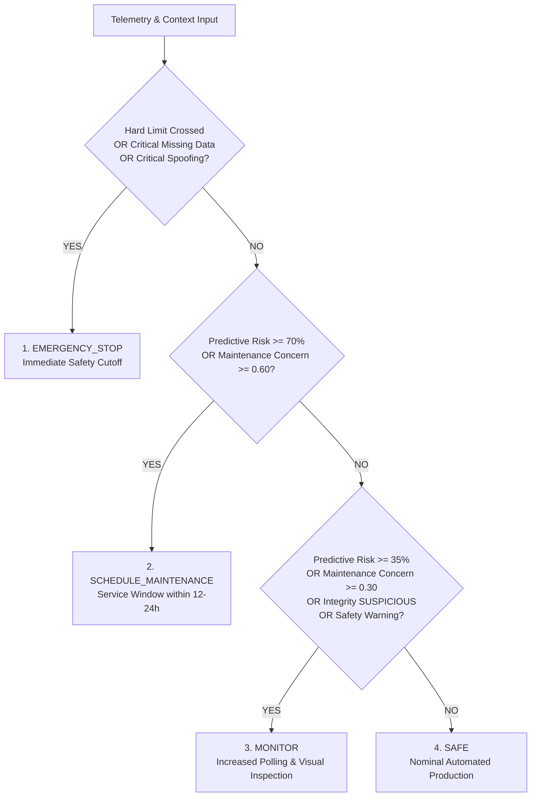

# Robotic Arm Joint Health Monitoring System

[](https://www.python.org/)
[](LICENSE)
[](tests/)

An industrial-grade, cyber-physical health monitoring and predictive maintenance system for six 6-axis articulated robotic arms operating on a manufacturing assembly line.

Synthesizes high-frequency joint telemetry (torque, temperature, vibration), historical degradation datasets, free-text technician maintenance notes, and adversarial sensor spoofing defense into **exactly one deterministic, explainable operational decision per robotic arm**.

> [!IMPORTANT]
> **SAFETY SYSTEM DISCLAIMER**: This software system is a simulation and diagnostic decision support tool. It is **NOT** a certified industrial safety controller (e.g., ISO 13849 PL-e, IEC 61508 SIL-3, IEC 62061). Real-world machinery requires independently engineered, validated hardware interlocks, dual-channel fail-safe safety relays, and certified emergency stop circuits.

---

## 1. Problem Statement & Scenario

In an automated manufacturing facility, six 6-axis robotic arms (`arm_1` through `arm_6`) execute continuous cyclic tasks. Each arm has six articulated joints:
- **Joint 1**: Base (Waist rotation)
- **Joint 2**: Shoulder (Primary vertical payload lift)
- **Joint 3**: Elbow (Dynamic arm reach)
- **Joint 4**: Wrist 1 (Pitch / elevation)
- **Joint 5**: Wrist 2 (Yaw / rotation)
- **Joint 6**: Wrist 3 (Roll / tool flange)

Each joint continuously reports:
1. **Joint Torque** ($\text{Nm}$)
2. **Joint Temperature** ($^\circ\text{C}$)
3. **Joint Vibration** ($\text{mm/s RMS}$)

Unplanned joint breakdowns cause severe line stoppage. Technicians log unstructured maintenance observations (e.g. *"clicking noise detected at shoulder"*, *"bearing replaced and lubrication completed"*). Concurrently, adversarial actors or sensor hardware faults can inject fake nominal telemetry to conceal underlying mechanical failures.

This system combines raw telemetry, historical wear patterns, natural language maintenance notes, and cyber-attack defense to produce **exactly one final decision for each robotic arm**.

---

## 2. Permitted Decisions & Priority Precedence

The system strictly enforces the following decision hierarchy:



1. **`EMERGENCY_STOP`** (Highest Priority): Any joint crosses a hard critical threshold, critical sensor data is missing/corrupted under the fail-safe policy, or a critical sensor spoofing attack is detected. **Cannot be overridden by machine learning predictions.**
2. **`SCHEDULE_MAINTENANCE`**: Credible high predictive failure risk ($\ge 70\%$) or strong unresolved maintenance evidence ($\ge 0.60$).
3. **`MONITOR`**: Moderate predicted risk ($\ge 35\%$), suspicious sensor integrity, active lower-level maintenance notes ($\ge 0.30$), or non-critical safety warnings.
4. **`SAFE`** (Lowest Priority): All 6 joints operating within limits, trustworthy telemetry, low predictive risk, and no unresolved maintenance concerns.

---

## 3. System Architecture & Component Design

```
robotic-arm-joint-health-monitoring/
├── config/
│   └── thresholds.json               # Configurable safety, predictive, and cyber thresholds
├── data/
│   ├── historical_joint_readings.csv # 2,160 historical records for ML training
│   ├── current_telemetry.csv         # 36 records snapshot covering all 6 arms and joints
│   ├── maintenance_logs.txt          # Unstructured technician field notes
│   └── spoofed_sensor_cases.csv      # Sequential multi-sample spoofing attack dataset
├── models/
│   └── predictive_model.joblib       # Serialized StandardScaler + RandomForest pipeline
├── outputs/
│   ├── arm_health_summary.csv        # Final arm decisions in tabular CSV format
│   ├── arm_health_summary.json       # Complete nested JSON diagnostic hierarchy
│   ├── joint_diagnostics.csv         # Joint-level telemetry and status breakdown
│   ├── spoof_detection_report.csv    # Sensor integrity evaluation results
│   ├── maintenance_analysis.json     # NLP parsed findings and stateful concern scores
│   ├── model_evaluation.json         # ML performance metrics (precision, recall, ROC-AUC)
│   └── final_report.md               # Human-readable markdown operational report
├── logs/
│   └── monitoring.log                # Execution and diagnostic audit trail
├── src/
│   ├── __init__.py
│   ├── config_loader.py              # Configuration schema loading and strict validation
│   ├── data_generator.py             # Reproducible synthetic data generation
│   ├── data_validator.py             # Telemetry schema validation and boundary checks
│   ├── safety_engine.py              # Immediate deterministic rule-based safety engine
│   ├── predictive_model.py           # Scikit-learn predictive wear classification pipeline
│   ├── train_model.py                # Chronological training and evaluation script
│   ├── spoof_detection.py            # Sensor integrity, frozen sensor, and anti-spoofing
│   ├── maintenance_log_analyzer.py   # Free-text NLP log analyzer and repair tracker
│   ├── decision_engine.py            # Multi-joint aggregation and priority synthesis
│   ├── reporting.py                  # Report generation and multi-format exporters
│   ├── generate_dataset.py           # CLI script to generate datasets
│   └── main.py                       # CLI orchestrator (simulation and batch modes)
├── tests/
│   ├── conftest.py                   # Pytest path and environment fixtures
│   ├── test_safety_engine.py         # Tests for safety thresholds and fail-safe policy
│   ├── test_spoof_detection.py       # Tests for frozen sensors, replay, and slew rate
│   ├── test_maintenance_log_analyzer.py # Tests for fault parsing and repair crediting
│   ├── test_decision_engine.py       # Tests for priority precedence and aggregation
│   └── test_pipeline.py              # Tests for schema error handling and CSV/JSON export
├── docs/
│   ├── architecture.md               # Detailed module interaction and design principles
│   ├── decision_logic.md             # Thresholds, decision precedence, and worked examples
│   ├── security_analysis.md          # Threat model, attack vectors, and fail-safe defenses
│   ├── report.md                     # Comprehensive technical engineering report
│   └── images/                       # Screenshots used in this README
│       ├── 01_dataset_generation.png
│       ├── 02_model_training.png
│       ├── 03_operational_summary.png
│       └── 04_pytest_results.png
├── pytest.ini                        # Pytest configuration
├── requirements.txt                  # Pinned Python package dependencies
└── README.md                         # Project documentation
```

---

## 4. Technology Stack

- **Python**: 3.11, 3.12, or 3.13
- **Data Engineering**: `pandas>=2.2.0`, `numpy>=2.0.0`
- **Machine Learning**: `scikit-learn>=1.5.0`, `joblib>=1.4.0`
- **Automated Testing**: `pytest>=8.0.0`
- **Zero Paid Dependencies**: NLP and cyber detection operate using rule engines, regular expressions, and statistical estimators without requiring commercial LLM APIs.

---

## 5. Installation & Setup

### A. Windows (PowerShell)
```powershell
# Clone or navigate to the project directory
cd E:\Occ

# Create virtual environment
python -m venv .venv

# Activate virtual environment
.\.venv\Scripts\Activate.ps1

# Upgrade pip and install dependencies
python -m pip install --upgrade pip
pip install -r requirements.txt
```

### B. Linux / macOS (Bash)
```bash
# Navigate to the project directory
cd robotic-arm-joint-health-monitoring

# Create virtual environment
python3 -m venv .venv

# Activate virtual environment
source .venv/bin/activate

# Upgrade pip and install dependencies
pip install --upgrade pip
pip install -r requirements.txt
```

---

## 6. Execution Instructions

### Step 1: Generate Datasets & Maintenance Logs
Generates historical training data (2,160 samples), snapshot telemetry (36 rows), maintenance logs, and spoofing test scenarios:
```bash
python -m src.generate_dataset
```

**Output:**


*Figure 1: Dataset generator creating the 2,160-row historical dataset, the 36-row current telemetry snapshot, 12 maintenance log lines and the 8-row spoofed sensor dataset.*

### Step 2: Train & Evaluate Predictive Maintenance Model
Trains the Random Forest wear classifier using chronological time-aware splitting, addresses class imbalance, and serializes the model to `models/predictive_model.joblib`:
```bash
python -m src.train_model
```

**Output:**


*Figure 2: Training on 1,728 samples and evaluation on 432 hold-out samples (Accuracy 0.9884, Precision 0.7333, Recall 0.9167, F1 0.8148, ROC-AUC 0.9970; TN=416, FP=4, FN=1, TP=11).*

### Step 3: Run the End-to-End Simulation
Demonstrates the full monitoring pipeline across all six robotic arms, clearly exercising **all four permitted operational decisions**:
```bash
python -m src.main --mode simulate
```

**Output:**


*Figure 3: Operational summary showing SAFE, MONITOR, SCHEDULE_MAINTENANCE and EMERGENCY_STOP decisions across the six arms, with the precedence EMERGENCY_STOP > SCHEDULE_MAINTENANCE > MONITOR > SAFE.*

### Step 4: Run Batch Analysis on Custom Files
Analyze custom telemetry files and maintenance notes:
```bash
python -m src.main --mode batch --input data/current_telemetry.csv --logs data/maintenance_logs.txt
```

### Step 5: Run Automated Tests
Execute the comprehensive test suite covering all 20 required scenarios:
```bash
pytest -v
```

**Output:**


*Figure 4: Verbose pytest run on Windows with Python 3.13.14 - all 22 tests passed in 1.33 seconds.*

---

## 7. Verified Simulation Results

When executed in simulation mode (`python -m src.main --mode simulate`), the system demonstrates each decision across different arms:

```
==========================================================================================
 ROBOTIC ARM JOINT HEALTH MONITORING SYSTEM - OPERATIONAL SUMMARY
==========================================================================================
ARM ID   | FINAL DECISION         | CRITICAL JOINT  | MAX RISK   | INTEGRITY      
------------------------------------------------------------------------------------------
arm_1    | SAFE                   | joint_1         | 0.0%       | TRUSTED        
arm_2    | MONITOR                | joint_3         | 45.1%      | TRUSTED        
arm_3    | SCHEDULE_MAINTENANCE   | joint_2         | 99.0%      | TRUSTED        
arm_4    | EMERGENCY_STOP         | joint_2         | 1.0%       | TRUSTED        
arm_5    | EMERGENCY_STOP         | joint_2         | 1.0%       | CRITICAL_INTEGRITY_FAILURE
arm_6    | EMERGENCY_STOP         | joint_2         | 1.9%       | TRUSTED        
==========================================================================================
```

### Decision Justifications:
- **`arm_1` (SAFE)**: All 6 joints operating within limits. Historical bearing wear on Joint 2 was resolved by a verified repair log (`"Bearing replaced and lubrication completed"`).
- **`arm_2` (MONITOR)**: Joint 3 (Elbow) exhibits moderate vibration (3.50 mm/s) yielding a calibrated 45.1% predictive wear risk and an active technician observation note (`"Increasing vibration observed near the elbow joint"`).
- **`arm_3` (SCHEDULE_MAINTENANCE)**: Joint 2 (Shoulder) reports 5.20 mm/s vibration (warning limit exceeded) and high maintenance age (2,450 hours), yielding a 99.0% 24-hour failure risk and an unresolved note (`"Abnormal clicking noise detected at shoulder under heavy load. Grinding suspected"`).
- **`arm_4` (EMERGENCY_STOP)**: Joint 2 temperature reaches 88.5°C, crossing the hard safety threshold of 85.0°C.
- **`arm_5` (EMERGENCY_STOP)**: Sensor integrity detector uncovers an adversarial frozen-sensor attack where vibration is artificially flatlined at 0.010 mm/s ($\sigma = 0.000000$) while torque and temperature rise. Triggers fail-safe emergency shutdown.
- **`arm_6` (EMERGENCY_STOP)**: Proves safety precedence! Joint 2 undergoes a critical torque excursion (338.0 Nm > 320.0 Nm limit). Even though the ML model predicted an ultra-low risk of 1.9% due to low operating hours, the deterministic safety engine immediately enforced an `EMERGENCY_STOP`.

---

## 8. Predictive Model Evaluation Metrics

Evaluated on 432 holdout samples using chronological time-aware splitting (positive failure rate: 2.8%):

| Metric | Score | Industrial Significance |
|:---|:---:|:---|
| **Accuracy** | `98.84%` | High baseline correctness. |
| **Precision** | `73.33%` | Avoids costly false alarms and unnecessary line halts. |
| **Recall** | `91.67%` | Catches 11 out of 12 impending joint breakdowns before failure. |
| **F1-Score** | `81.48%` | Strong harmonic balance between precision and recall. |
| **ROC-AUC** | `99.70%` | Outstanding discriminative ranking capability. |

The training run that produced these metrics is shown in [Figure 2](#step-2-train--evaluate-predictive-maintenance-model).

---

## 9. Understanding Generated Output Artifacts

| Output File | Format | Description |
|:---|:---:|:---|
| `outputs/arm_health_summary.csv` | CSV | High-level arm summary table with decisions, highest risk joints, risk %, and recommended operator actions. |
| `outputs/arm_health_summary.json` | JSON | Complete nested hierarchical records including arm decisions and all 6 joint diagnostics. |
| `outputs/joint_diagnostics.csv` | CSV | Granular per-joint telemetry (torque, temp, vibration), safety statuses, predictive risks, and reasons. |
| `outputs/spoof_detection_report.csv` | CSV | Sensor integrity analysis results, suspicion scores, and anomaly detection reasons. |
| `outputs/maintenance_analysis.json` | JSON | Parsed technician log notes, categorized fault observations, and active vs. resolved issues per arm/joint. |
| `outputs/model_evaluation.json` | JSON | Model training parameters, confusion matrix, and class imbalance documentation. |
| `outputs/final_report.md` | Markdown | Comprehensive human-readable operational and safety audit report. |
| `logs/monitoring.log` | Log | Execution timestamps, severity levels, diagnostic warnings, and audit trail. |

---

## 10. Automated Testing Verification

The project includes 22 automated test cases in `tests/`:
```bash
pytest -v
```
All 22 tests pass in about 1-2 seconds (see [Figure 4](#step-5-run-automated-tests)):
- Normal telemetry produces `SAFE`.
- Critical torque, temperature, and vibration immediately trigger `EMERGENCY_STOP`.
- Emergency stop cannot be overridden by low ML risk.
- Safety checks operate when no trained model is available.
- Moderate risk produces `MONITOR`; high risk produces `SCHEDULE_MAINTENANCE`.
- Unresolved technician notes increase concern; irrelevant notes are ignored.
- Documented repairs clear previous concerns on matching arm/joint.
- Frozen sensor attacks, replayed timestamps, and step-jumps are detected.
- Missing and `NaN` sensor data triggers fail-safe emergency stop.
- Every arm receives exactly one valid decision; multi-joint alerts aggregate correctly.
- Invalid configuration files raise structured `ConfigurationError`.
- Dataset generation is reproducible using the fixed random seed.

---

## 11. Configuration Customization

All operational thresholds are defined in `config/thresholds.json`. Modify values directly to adjust:
- Joint-specific torque warning and critical boundaries.
- Temperature and vibration warning/critical limits.
- Predictive maintenance risk boundaries (`monitor_risk_threshold`, `maintenance_risk_threshold`).
- Technician maintenance concern thresholds (`monitor_concern_threshold`, `maintenance_concern_threshold`).
- Cyber spoofing parameters (window size, noise floor, slew rate limits).
- Missing telemetry fail-safe policies.

The system strictly validates configuration at startup and aborts with helpful error messages if unsafe values (e.g. warning $\ge$ critical) are detected.

---

## 12. Technical Documentation Index

For in-depth technical documentation, refer to the `docs/` folder:
- [System Architecture (`docs/architecture.md`)](docs/architecture.md): Detailed subsystem designs and data flow diagrams.
- [Decision Logic (`docs/decision_logic.md`)](docs/decision_logic.md): Priority hierarchy, threshold definitions, and worked case studies.
- [Security Analysis (`docs/security_analysis.md`)](docs/security_analysis.md): Cyber threat model, attack vectors, detection algorithms, and trade-offs.
- [Engineering Report (`docs/report.md`)](docs/report.md): Full technical project report with executed runs, metrics, and conclusions.

---

## 13. License

This project is licensed under the MIT License.
