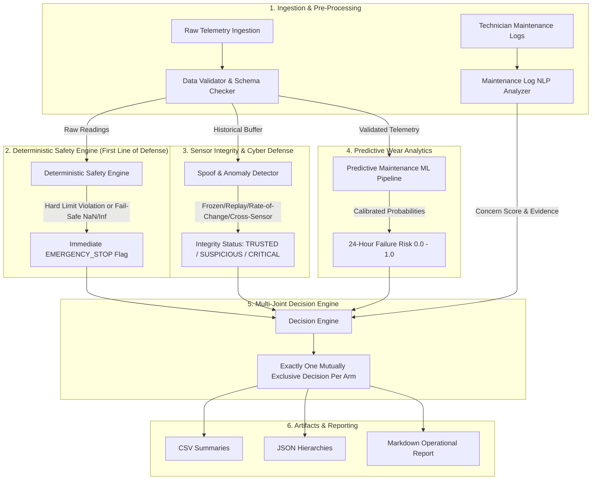

# System Architecture & Technical Design

## 1. Executive Architecture Overview

The **Robotic Arm Joint Health Monitoring System** is an industrial cyber-physical monitoring platform designed to oversee six 6-axis articulated robots on an automated manufacturing line.

Industrial robotics operate under strict safety, reliability, and security constraints. A software failure or delayed safety reaction can lead to catastrophic mechanical destruction, extended production downtime, or severe personnel hazards. To guarantee real-time safety while providing proactive predictive intelligence, this system decouples **immediate deterministic safety rules** from **machine learning analytics** and **sensor integrity validation**.

---

## 2. Module Responsibilities and Separation of Concerns

### A. Data Validator (`src/data_validator.py`)
- **Responsibility**: Ingestion schema validation and physical boundary verification.
- **Rules**:
  - Enforces mandatory columns: `timestamp`, `arm_id`, `joint_id`, `torque`, `temperature`, `vibration`.
  - Flags non-numeric values, `NaN`, `+Inf`, and `-Inf`.
  - Rejects malformed records and validates arm identifiers (`arm_1` through `arm_6`) and joint identifiers (`joint_1` through `joint_6`).

### B. Immediate Safety Engine (`src/safety_engine.py`)
- **Responsibility**: Deterministic, hard-coded safety boundary enforcement.
- **Independence Principle**: Executes **prior to** and **independently of** machine learning models, anomaly detection, or text analysis.
- **Mechanisms**:
  - Compares joint torque against joint-specific physical limits (e.g., Joint 2 Shoulder critical limit: 320 Nm; Joint 6 Wrist 3 critical limit: 45 Nm).
  - Compares bearing temperature against thermal thresholds (warning: 75°C, critical: 85°C).
  - Compares vibration against ISO 10816 standards (warning: 4.5 mm/s RMS, critical: 7.0 mm/s RMS).
  - Implements **fail-safe policy**: Missing telemetry, `NaN`, or infinite sensor inputs immediately trigger an `EMERGENCY_STOP`.
  - Low machine learning predictions are mathematically incapable of overriding a safety stop.

### C. Sensor Integrity & Spoof Detection (`src/spoof_detection.py`)
- **Responsibility**: Detects adversarial sensor manipulation, telemetry interception, and hardware sensor failures.
- **Defense Mechanisms**:
  - **Frozen Sensor Detection**: Analyzes rolling window variance; zero variance ($\sigma < 10^{-4}$) on active joints triggers spoof alerts.
  - **Rate-of-Change (Slew Rate) Limits**: Detects physically impossible step-jumps violating mechanical or thermal inertia.
  - **Cross-Sensor Consistency**: Verifies physical coupling (e.g., flags high motor torque and high temperature paired with artificially flatlined vibration).
  - **Replay Defense**: Caches historical timestamps and verifies strict temporal monotonicity.

### D. Technician Maintenance Log Analyzer (`src/maintenance_log_analyzer.py`)
- **Responsibility**: Plain-text natural language understanding for unstructured technician logs.
- **Mechanisms**:
  - Zero external dependencies: uses regex entity extractors and categorized domain dictionaries.
  - Maps natural language joint terms (`shoulder`, `elbow`, `wrist pitch`) to canonical IDs (`joint_2`, `joint_3`, `joint_4`).
  - Distinguishes **fault observations** (wear, clicking noise, gear backlash, overheating) from **verified repairs** (bearing replaced, lubrication completed, calibration).
  - Deduplicates overlapping sub-phrases and takes category-maximal severity weights.
  - Verified repairs clear previously accumulated concern scores on matching arms and joints.
  - Automatically filters operational chatter (cleaning, shift changes, inventory updates).

### E. Predictive Maintenance Model (`src/predictive_model.py` & `src/train_model.py`)
- **Responsibility**: Supervised probabilistic wear estimation over a 24-hour horizon.
- **Architecture**:
  - `StandardScaler` + `RandomForestClassifier` (100 estimators, depth 8, balanced class weighting).
  - Trained using **chronological time-aware splitting** to prevent temporal data leakage.
  - Evaluated on Accuracy, Precision, Recall, F1-Score, and ROC-AUC.
  - Safe fallback: if model weights are unavailable, defaults to risk score 0.0 with logged warnings, allowing deterministic safety rules to operate unimpeded.

### F. Multi-Joint Decision Engine (`src/decision_engine.py`)
- **Responsibility**: Multi-sensor fusion and decision synthesis across all 6 joints of each robotic arm.
- **Priority Hierarchy**:
  1. `EMERGENCY_STOP`: Triggered by any hard safety violation, critical missing telemetry, or critical sensor spoofing.
  2. `SCHEDULE_MAINTENANCE`: Triggered by high predictive failure risk ($\ge 70\%$) or severe maintenance concern ($\ge 0.60$).
  3. `MONITOR`: Triggered by moderate predictive risk ($\ge 35\%$), active maintenance notes ($\ge 0.30$), suspicious sensor integrity, or non-critical safety warnings.
  4. `SAFE`: Nominal operation across all 6 joints with trusted telemetry.

### G. Reporting & Export (`src/reporting.py`)
- **Responsibility**: Structured telemetry logging and reporting.
- **Artifacts**:
  - `outputs/arm_health_summary.csv`
  - `outputs/arm_health_summary.json`
  - `outputs/joint_diagnostics.csv`
  - `outputs/spoof_detection_report.csv`
  - `outputs/maintenance_analysis.json`
  - `outputs/model_evaluation.json`
  - `outputs/final_report.md`
