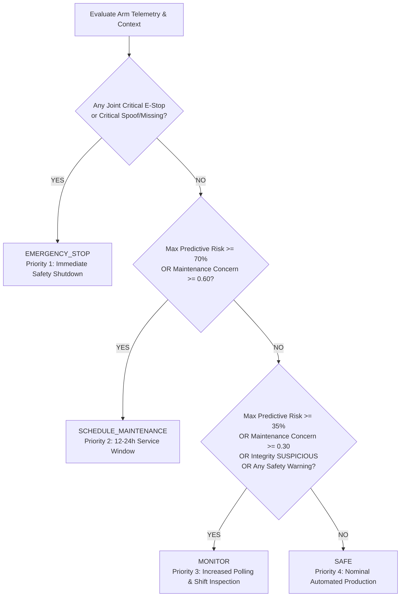

# Decision Logic & Operational Thresholds

## 1. Decision Precedence Hierarchy

The Robotic Arm Joint Health Monitoring System enforces a strict, deterministic priority hierarchy to synthesize exactly one mutually exclusive decision per robotic arm:

---

## 2. Configurable Operational Thresholds

All thresholds are centralized in `config/thresholds.json` and validated strictly at application startup.

### A. Global Environmental and Dynamics Safety Limits
| Parameter | Unit | Warning Limit | Critical Safety Limit | Physical Bounds |
|:---|:---:|:---:|:---:|:---:|
| **Bearing Temperature** | °C | 75.0 | 85.0 | [-20.0, 150.0] |
| **Vibration Velocity** | mm/s RMS | 4.5 | 7.0 | [0.0, 50.0] |
| **Default Joint Torque** | Nm | 180.0 | 220.0 | [-400.0, 400.0] |

### B. Joint-Specific Torque Thresholds
Articulated 6-axis robots experience vastly differing dynamic loads depending on joint positioning:
| Joint ID | Name & Location | Warning Torque (Nm) | Critical Torque (Nm) | Primary Mechanical Vulnerability |
|:---|:---|:---:|:---:|:---|
| `joint_1` | Base (Waist Rotation) | 170.0 | 210.0 | Turntable slew ring bearing wear |
| `joint_2` | Shoulder (Main Vertical Lift) | 260.0 | 320.0 | Primary cycloidal gearbox failure under payload |
| `joint_3` | Elbow (Dynamic Extension) | 190.0 | 230.0 | Harmonic drive flexspline stress & fatigue |
| `joint_4` | Wrist 1 (Pitch / Elevation) | 55.0 | 70.0 | Small planetary drive tooth shear |
| `joint_5` | Wrist 2 (Yaw / Rotation) | 45.0 | 60.0 | Belt tension slippage and servo overheating |
| `joint_6` | Wrist 3 (Roll / Tool Flange) | 35.0 | 45.0 | End-effector tooling collision shock |

### C. Predictive Wear & Maintenance Concern Thresholds
| Parameter | Classification Threshold | Action Triggered |
|:---|:---:|:---|
| **Predictive 24h Failure Risk** | $\ge 70.0\%$ | `SCHEDULE_MAINTENANCE` |
| **Predictive 24h Failure Risk** | $\ge 35.0\%$ | `MONITOR` |
| **Maintenance Log Concern** | $\ge 0.60$ | `SCHEDULE_MAINTENANCE` |
| **Maintenance Log Concern** | $\ge 0.30$ | `MONITOR` |

### D. Sensor Integrity & Spoofing Suspicion Thresholds
| Metric | Threshold | Classification |
|:---|:---:|:---|
| **Rolling Window Samples** | 5 consecutive samples | Sample buffer size |
| **Frozen Sensor Noise Floor** | $\sigma < 0.0001$ | Frozen sensor attack |
| **Max Torque Slew Rate** | $> 120.0\text{ Nm/sample}$ | Impossible mechanical impulse jump |
| **Max Temperature Slew Rate** | $> 12.0^\circ\text{C/sample}$ | Impossible thermal jump |
| **Cross-Sensor Contradiction** | Torque $> 150\text{ Nm}$, Temp $> 70^\circ\text{C}$, Vib $< 0.05\text{ mm/s}$ | Artificially suppressed vibration |
| **Overall Suspicion Score** | $\ge 0.85$ | `CRITICAL_INTEGRITY_FAILURE` $\rightarrow$ `EMERGENCY_STOP` |
| **Overall Suspicion Score** | $\ge 0.45$ | `SUSPICIOUS` $\rightarrow$ `MONITOR` |

---

## 3. Case Studies: Worked Examples from Simulation

### Arm 1: Nominal Healthy Baseline $\rightarrow$ `SAFE`
- **Telemetry**: All 6 joints operating within normal boundaries (Torque: 15–162 Nm, Temp: 37–49°C, Vibration: 0.8–1.6 mm/s).
- **Predictive Risk**: 0.0% across all joints.
- **Maintenance Notes**: An earlier minor vibration note on Joint 2 was followed by: `"Bearing replaced and lubrication completed. Restored to nominal."` Concern score cleared to 0.00.
- **Sensor Integrity**: `TRUSTED` (Suspicion: 0.00).
- **Result**: `SAFE`. Continuous production permitted.

### Arm 2: Moderate Wear & Elevated Vibration $\rightarrow$ `MONITOR`
- **Telemetry**: Joint 3 (Elbow) exhibits elevated vibration (3.50 mm/s) and temperature (58.0°C).
- **Predictive Risk**: 45.1% estimated failure risk within 24 hours.
- **Maintenance Notes**: `"Increasing vibration observed near the elbow joint."` (Concern score: 0.45).
- **Sensor Integrity**: `TRUSTED`.
- **Precedence Evaluation**: No hard safety threshold crossed; predictive risk $\ge 35\%$ and concern score $\ge 0.30$.
- **Result**: `MONITOR`. Increase sampling rate; schedule inspection during next shift.

### Arm 3: Severe Mechanical Wear $\rightarrow$ `SCHEDULE_MAINTENANCE`
- **Telemetry**: Joint 2 (Shoulder) reports 5.20 mm/s RMS vibration (above warning 4.5 mm/s) and 72.0°C temperature with 2450 operating hours since maintenance.
- **Predictive Risk**: 99.0% probability of failure within 24 hours.
- **Maintenance Notes**: `"Abnormal clicking noise detected at shoulder under heavy load. Grinding suspected."` (Concern score: 0.55).
- **Precedence Evaluation**: Critical safety limits not yet crossed, but predictive risk ($99.0\% \ge 70\%$) mandates proactive intervention.
- **Result**: `SCHEDULE_MAINTENANCE`. Plan mechanical servicing window within 12–24 hours to swap bearings/gearbox.

### Arm 4: Critical Thermal Excursion $\rightarrow$ `EMERGENCY_STOP`
- **Telemetry**: Joint 2 (Shoulder) temperature spikes to 88.5°C, exceeding the hard critical limit of 85.0°C.
- **Predictive Risk**: 1.0% (historical usage was low, but immediate thermal runaway occurred).
- **Safety Violation**: Hard limit violated immediately during Step 2 safety check.
- **Result**: `EMERGENCY_STOP`. Immediate mechanical brake engagement and motor cutoff.

### Arm 5: Adversarial Sensor Spoofing $\rightarrow$ `EMERGENCY_STOP`
- **Telemetry**: Joint 2 reports high load (200 Nm) and high temp (76°C), but vibration is flatlined at exactly 0.010 mm/s across 6 consecutive samples ($\sigma = 0.000000$).
- **Integrity Analysis**: Cross-sensor contradiction detected; sensor noise floor violation detected; frozen telemetry detected. Suspicion score = 0.95 (`CRITICAL_INTEGRITY_FAILURE`).
- **Fail-Safe Response**: The true physical state of Arm 5 is untrustworthy and unobservable.
- **Result**: `EMERGENCY_STOP`. Automatic safety stop engaged under cyber fail-safe policy.

### Arm 6: Overriding Low Model Risk $\rightarrow$ `EMERGENCY_STOP`
- **Scenario Proof**: Proves that a low predictive risk score **cannot** override an immediate physical safety limit.
- **Telemetry**: Joint 2 experiences an instantaneous mechanical shock load of 338.0 Nm (exceeding critical 320.0 Nm limit).
- **Predictive Risk**: Model predicts only **1.9% risk** because component operating hours and maintenance age are fresh.
- **Safety Engine Evaluation**: Deterministic safety engine flags critical violation immediately in Step 2.
- **Result**: `EMERGENCY_STOP`. The ML model's low prediction is completely disregarded in favor of the deterministic safety boundary.
