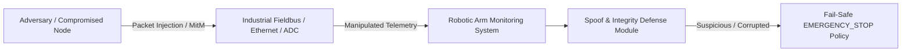

# Sensor Integrity & Cybersecurity Analysis

## 1. Threat Model & Attack Surface

In industrial automation and cyber-physical systems (CPS), sensor telemetry streams are vulnerable to both internal and perimeter attacks. An adversary targeting an assembly line robotic arm may seek to cause physical equipment destruction, bypass quality inspections, or create dangerous shop-floor hazards.

### Attack Vectors Analyzed:
1. **Concealment Attack ("Frozen Low")**: An attacker modifies sensor packets to report artificially low vibration (e.g. 0.01 mm/s) or torque to conceal an impending bearing failure or deliberate physical sabotage.
2. **Replay Attack**: Stored captures of nominal, healthy telemetry are re-injected onto the fieldbus to create a false illusion of system health while physical machinery degrades.
3. **Sensor Teleportation / Step-Jump Attack**: Injecting arbitrary values that introduce abrupt discontinuities violating physical inertia (such as instantaneous 30°C temperature jumps).
4. **Thermodynamic / Mechanical Decoupling Attack**: Faking low readings on one sensor while leaving physically coupled sensors untouched (e.g. reporting 200 Nm continuous torque and 76°C thermal rise while reporting zero vibration).

---

## 2. Detection Methodology & Algorithmic Defense

The `SpoofDetector` module (`src/spoof_detection.py`) integrates deterministic, temporal, and statistical algorithms:

### A. Rolling Window Noise Floor Verification
- **Physical Principle**: Accelerometers and strain gauges on active industrial robots always exhibit non-zero stochastic noise (Gaussian baseline jitter caused by bearing rotation and environmental vibration).
- **Algorithm**: The detector maintains a rolling FIFO window of $W = 5$ samples per $(arm, joint)$. It computes the empirical standard deviation:
  $$\sigma = \sqrt{\frac{1}{W} \sum_{i=1}^W (x_i - \bar{x})^2}$$
  If $\sigma < 10^{-4}\text{ mm/s}$ across consecutive samples while the arm is operational, a frozen sensor attack is flagged.

### B. Kinematic & Thermodynamic Rate-of-Change (Slew Rate) Boundaries
- **Physical Principle**: Joint temperature cannot instantaneously rise or fall faster than conductive/convective heat dissipation rates. Torque changes are bounded by motor inductance and amplifier current slew rates.
- **Algorithm**:
  $$\frac{|\Delta x|}{\Delta t} \le \text{Max Allowed Slew Rate}$$
  - $\Delta \text{Torque} \le 120.0\text{ Nm/sample}$
  - $\Delta \text{Temperature} \le 12.0^\circ\text{C/sample}$
  - $\Delta \text{Vibration} \le 4.5\text{ mm/s/sample}$
  Exceeding these limits penalizes the suspicion score.

### C. Cross-Sensor Thermodynamic Consistency
- **Physical Principle**: In an electric actuator, mechanical power loss dissipates as heat ($P_{\text{loss}} \approx I^2 R$) and mechanical vibration. High torque coupled with continuous high temperature cannot realistically produce zero vibration.
- **Algorithm**: The detector checks physical co-variance:
  $$\text{If } (\text{Torque} > 150\text{ Nm}) \land (\text{Temp} > 70^\circ\text{C}) \land (\text{Vibration} < 0.05\text{ mm/s}) \implies \text{Severe Inconsistency}$$

### D. Cryptographic and Temporal Replay Defense
- **Physical Principle**: Telemetry streams must adhere to strictly monotonic clock increments.
- **Algorithm**: The detector caches seen timestamp signatures $H(t)$. Duplicate timestamps trigger immediate replay alerts; non-monotonic timestamp arrival triggers out-of-order integrity alerts.

---

## 3. Fail-Safe Policy on Telemetry Compromise

In safety-critical industrial operations, **untrustworthy telemetry cannot be treated as nominal**. When an attacker successfully corrupts sensor telemetry, the monitoring system loses observability over the true state of the physical plant.

- **Policy**:
  - Suspicion Score $\ge 0.85 \implies \text{CRITICAL\_INTEGRITY\_FAILURE} \implies \text{EMERGENCY\_STOP}$.
  - Suspicion Score $\ge 0.45 \implies \text{SUSPICIOUS} \implies \text{MONITOR}$.
- **Rationale**: An emergency shutdown prevents machinery damage and operator hazard when sensor telemetry is unverified or spoofed.

---

## 4. Trade-Off Analysis: False Positives vs. False Negatives

| Defense Parameter | Aggressive Setting (High Sensitivity) | Conservative Setting (High Specificity) | Selected System Balance |
|:---|:---|:---|:---|
| **Noise Floor ($\sigma_{\text{min}}$)** | High ($0.01$) $\rightarrow$ Risk of flagging idle robot as spoofed | Low ($10^{-5}$) $\rightarrow$ Risk of missing quantized spoof attack | $0.0001\text{ mm/s}$ (Balanced) |
| **Slew Rate ($\Delta T_{\text{max}}$)** | $5^\circ\text{C}$ $\rightarrow$ False alarms during sudden welding operations | $30^\circ\text{C}$ $\rightarrow$ Attacker can inject severe thermal shocks | $12^\circ\text{C/sample}$ |
| **Fail-Safe Threshold** | Low ($0.60$) $\rightarrow$ Nuisance emergency stops, production loss | High ($0.95$) $\rightarrow$ Machine operates with compromised sensors | $0.85$ (Critical threshold) |

---

## 5. Limitations & Future Hardening

### Remaining Security Limitations:
1. **Coordinated Multi-Sensor Replay**: If an attacker intercepts and replays all three sensor channels (torque, temperature, vibration) synchronously from a valid historical operating run with matching timestamps updated, statistical cross-sensor checks alone cannot detect the attack.
2. **Stealth Sensor Drift**: An attacker introducing slow, imperceptible bias drift ($\epsilon \approx 0.01\text{ mm/s per hour}$) will bypass rate-of-change and noise floor checks while gradually shifting predictive model outputs.

### Recommended Industrial Countermeasures:
- **Fieldbus Cryptography**: Implement IEEE 802.1AR Secure Device Identity and IPsec / MACsec encryption on industrial Ethernet (PROFINET / EtherCAT).
- **Hardware Enclaves (TPM / HSM)**: Sign sensor measurements at the microcontroller ADC level using asymmetric ECC keys (e.g. Ed25519) with embedded hardware sequence numbers.
- **Dual-Channel Dissimilar Sensors**: Utilize redundant, dissimilar physical sensors (e.g. piezoelectric accelerometer paired with acoustic emission microphone and motor current signature analysis).
